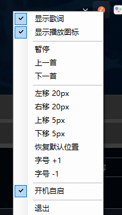

# 波点音乐任务栏歌词（BodianLyrics）

把「波点音乐」PC 版的播放信息搬到 Windows 11 任务栏上：一条单行歌词，已唱的字用主题色逐字高亮，还能直接在歌词上点击切歌。

- 目标系统：Windows 11（任务栏在上 / 在下都支持）
- 宿主播放器：波点音乐 PC 版
- 实现：C#（.NET Framework 4），只用系统自带的 `csc.exe` 编译，无第三方依赖、无 NuGet
- 本程序完全由 TRAE CN-Auto 模型开发

## 功能

| 能力 | 说明 |
| --- | --- |
| 任务栏歌词条 | 单行水平居中；超长行按 1px 步长自动降字号，最小 11px |
| 逐字卡拉 OK 高亮 | 酷我 LRC 的逐字标签，已唱部分为主题橙，未唱部分为浅灰 |
| 空档回退歌名 | 前奏、间奏、无歌词时直接显示当前歌曲名 |
| 点击播控 | 点歌词 = 播放 / 暂停；点左侧 = 上一首；点右侧 = 下一首 |
| 两侧媒体图标 | 胶囊两端绘制 ⏮ / ⏭，与文字同一条垂直中轴线，托盘里可一键关闭 |
| 托盘菜单 | 显示歌词、显示播放图标、播放 / 暂停、上一首、下一首、左右上下微调、恢复默认位置、字号 ±1、开机自启、退出 |
| 配置持久化 | 位置、字号、主题色、延迟、各开关全部写入 `config.ini` |

## 界面效果


任务栏上的歌词条（右侧胶囊），与系统托盘、时钟同处一条任务栏。


歌词条特写：已唱的字为主题橙（`#FF7A45`），未唱的字为浅灰；胶囊左右两端是 ⏮ / ⏭ 图标。点击文字区 = 播放 / 暂停，点左侧 = 上一首，点右侧 = 下一首。



托盘右键菜单：`显示歌词` / `显示播放图标` 为勾选项，下面是播放控制、位置与字号微调、开机自启、退出。

- **悬停区域**：整块胶囊都能点，其中文字区为播放 / 暂停，文字左侧为上一首，文字右侧为下一首；胶囊以外的任务栏区域照常可用

## 实现原理

### 1. 状态源：读日志，不注入进程

监听波点日志 `%LOCALAPPDATA%\cn.wenyu.bodian\bodian_pc\bdlog\log_0.log`，增量读取并按行解析：

| 日志片段 | 用途 |
| --- | --- |
| `play: name: <歌单>, index: ..., name: <歌名>, id: <musicId>` | 切歌、当前曲目 id |
| `mpv playing event=true/false` | 播放 / 暂停 |
| `歌曲的完整参数信息:{id: ..., duration: <秒>}` | 时长（校验 id 必须是当前曲目） |
| `stat, BOD_PLAY_MUSIC,2%09...RID:<id>|DUR:<秒>` | 时长（同样校验 id） |
| `xduration=<毫秒>` | 仅作兜底：它出现在预取任务里，经常是下一首甚至别的歌 |

### 2. 歌词：酷我移动端接口 + 逐字时间重映射

请求 `http://mlyric.kuwo.cn/mobi.s?f=bodian&q=<base64>`（参数里带 `type=lyric&req=2&lrcx=1&rid=<id>&songname=<name>`），返回 JSON 里再 base64 解出 LRC。

逐字标签形如 `[00:47.760]<0,2250>微<2250,120>微<...>`。实测标签刻度与本行的真实演唱时长并不成比例（AI 生成歌词 + 多次转码的常见问题），按绝对时间渲染会出现「这一行还没扫完就换行」。所以只保留行内相对进度，再把它拉伸到 `[行首, 行尾]` 区间，保证最后一个字正好在本行结束时唱完；同时做 20ms 单调性钳制，避免标签回跳。

### 3. 进度同步：用像素反推时长

`PrintWindow(hwnd, PW_RENDERFULLCONTENT)` 截取播放器窗口底部进度条那一行像素，按亮度阶跃聚类找进度条左端与实际边界，算出比例 `ratio`。进度条比例与日志经过时间严格线性，于是：

- 真实时长 ≈ `Δ日志时间 / Δratio`（绕开日志里经常串曲的时长字段）
- 「日志播放事件」与「真实出声」的偏差：多帧平均后写进 `Latency`

有像素时用像素校正；窗口最小化 / 完全隐藏时退化成纯日志时间推算。

### 4. 播控：向隐藏窗口转发点击

波点的播放按钮控件在隐藏窗口里，直接 `PostMessage` 鼠标消息过去：

- `x = 窗口宽 / 2 - 5 + offset`，`y = 窗口高 - 56`
- 播放 / 暂停 `offset = 0`，上一首 `-62`，下一首 `+62`

### 5. 叠加层：任务栏上的分层窗口

- `SHAppBarMessage(ABM_GETTASKBARPOS)` 取任务栏矩形与停靠边，跟随任务栏定位（上 / 下都行）
- `WS_EX_LAYERED | WS_EX_NOACTIVATE | WS_EX_TOOLWINDOW`，用 `UpdateLayeredWindow` 推预乘 32bpp DIB
- 不注册 `WS_EX_TRANSPARENT`，而是在 `WM_NCHITTEST` 里按「是否在胶囊内 + 在文字左 / 中 / 右」返回 `HTCLIENT` 或 `HTTRANSPARENT`：歌词条可点，其余位置不挡住任务栏
- 字体：`config.ini` 的 `FontName` 留空时自动选择——优先用系统已装的苹方（`苹方 中等` / `苹方 常规` / `PingFang SC`），否则回退到微软雅黑粗体；指定字体名时直接使用（需系统已安装）

## 构建

```powershell
powershell -ExecutionPolicy Bypass -File build.ps1
```

`build.ps1` 直接调用系统自带的 `C:\Windows\Microsoft.NET\Framework64\v4.0.30319\csc.exe`，所以不需要安装 .NET SDK。编译产物是单文件 `BodianLyrics.exe`。

运行 `BodianLyrics.exe`，托盘出现橙色 ♪ 图标即启动；`BodianLyrics.exe --probe` 会输出一次 `probe.txt` 用于排查（当前曲目、歌词行、进度比例等）。

## 配置（config.ini，与 exe 同目录）

| 键 | 含义 | 默认 |
| --- | --- | --- |
| `Width` | 歌词条窗口宽度（px） | 620 |
| `RightMargin` | 距任务栏右端的距离（px），越小越靠右 | 460 |
| `OffsetY` | 相对任务栏顶部的垂直偏移（px） | 0 |
| `FontSize` | 字号（px），超长行会自动往下缩 | 20 |
| `AccentR/G/B` | 已唱文字的主题色 | 255 / 122 / 69 |
| `Enabled` | 是否显示歌词 | 1 |
| `AutoStart` | 开机自启（写 HKCU Run） | 0 |
| `ShowPill` | 是否绘制胶囊底（默认关闭，纯透明） | 0 |
| `ShowIcons` | 是否显示两侧 ⏮ / ⏭ 图标 | 1 |
| `Latency` | 日志事件与真实出声的偏差（秒），自动学习 | 0 |
| `FontName` | 歌词字体名，留空自动选择（优先苹方，回退微软雅黑）；填系统已安装的字体名即可 | （空） |

## 已知限制

- 只适配波点音乐 PC 版：依赖它当前的日志格式、播放器窗口尺寸与按钮坐标
- 播放器窗口被完全隐藏时读不到进度条，只能靠日志时间推算，可能有秒级偏差
- 逐字歌词由酷我生成，个别行的时间刻度仍不准（已做重映射，但无法保证 100% 对齐）
- 胶囊宽度固定 620px：若把 `Width` 改得很小，两侧「上一首 / 下一首」热区会被压窄

## 目录

```
BodianLyrics/
├─ Program.cs      入口、单实例互斥、DPI 感知、--probe 探针
├─ Config.cs       config.ini 读写
├─ PlayerCore.cs   日志监听、播放状态、窗口点击转发、进度像素读取
├─ LyricsCore.cs   酷我歌词接口、LRC 解析、逐字重映射
├─ Overlay.cs      任务栏分层窗口、绘制、鼠标热区
├─ TrayApp.cs      托盘菜单、进度同步与延迟学习
├─ Probe.cs        命令行探针（输出 probe.txt）
└─ build.ps1       一键编译
```